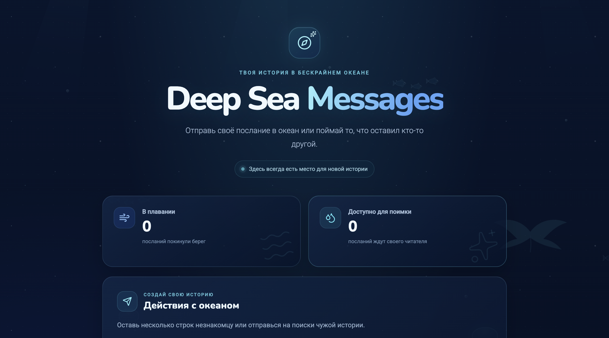

# 🌊 Bottleneck

[](https://go.dev/)
[](https://react.dev/)
[](https://www.docker.com/)
[](https://prometheus.io/)

Production-ready API для имитации отложенной доставки сообщений (Delayed Queue), построенный с упором на DevOps best practices, наблюдаемость (observability) и отказоустойчивость.

## 🎯 О проекте
Это не просто "игра", а инфраструктурный полигон. Проект демонстрирует, как должен выглядеть современный микросервис:
- **Безопасность:** Бэкенд полностью скрыт за Nginx Reverse Proxy. Пользователь не имеет прямого доступа к Go-порту.
- **Защита от перегрузок:** Собственный Sliding Window Rate Limiter на уровне приложения (3 сек/IP).
- **Наблюдаемость:** Нативная интеграция с Prometheus (счетчики, gauge, гистограммы времени ответа).
- **Ресурсоэффективность:** Multistage Docker build (Alpine), non-root пользователь, строгие resource limits в Docker Compose.
- **Надежность:** Graceful shutdown для корректного завершения активных запросов при деплое.

## 🏗 Архитектура
```text
[User Browser] 
      ↓ (HTTP/HTTPS)
[Nginx Reverse Proxy] ← (Rate Limiting, Gzip, Caching, Security Headers)
      ↓ (Internal Docker Network)
[Go API Server] ←→ [Redis] (TTL-based delayed queue persistence)
      ↓ (Scraping)
[Prometheus] (Metrics collection)